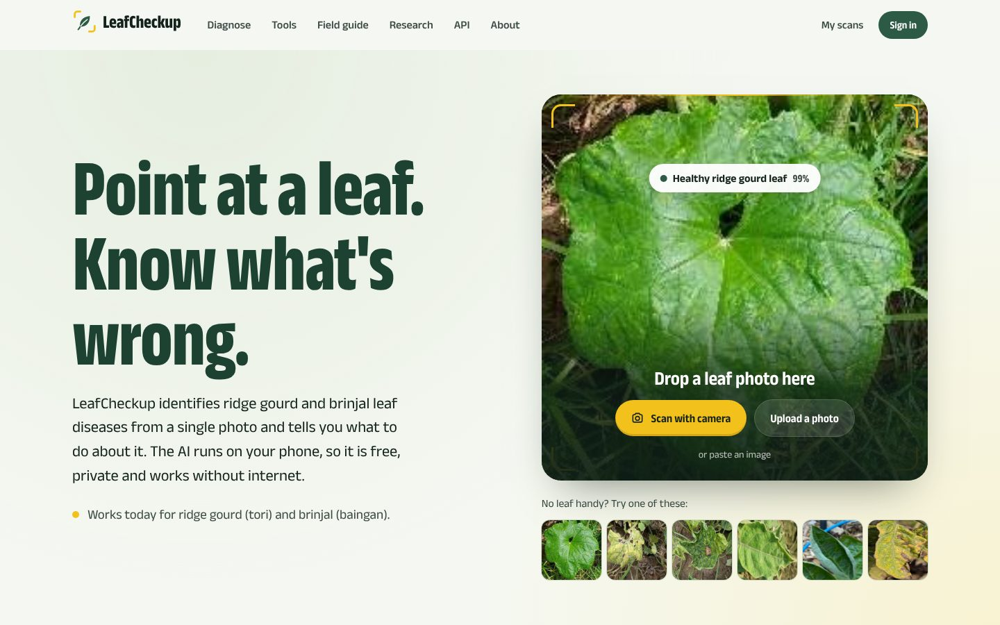
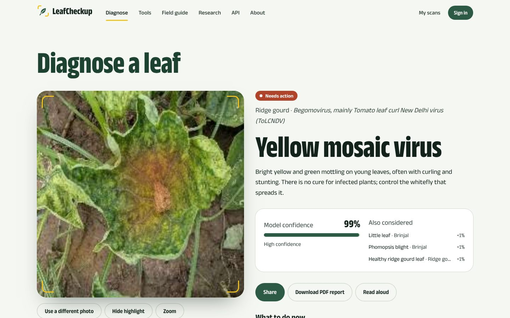
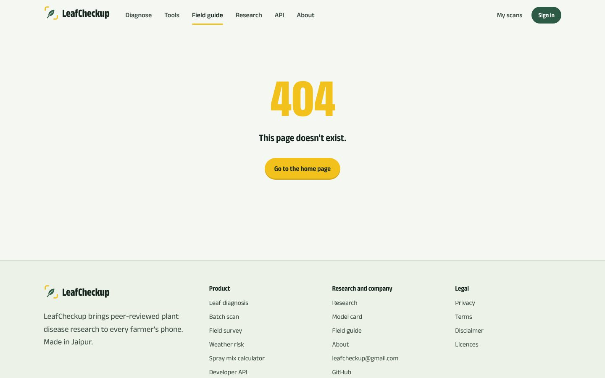
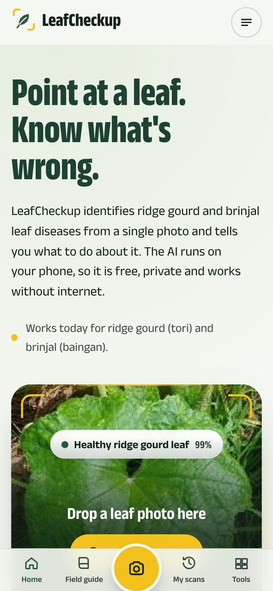
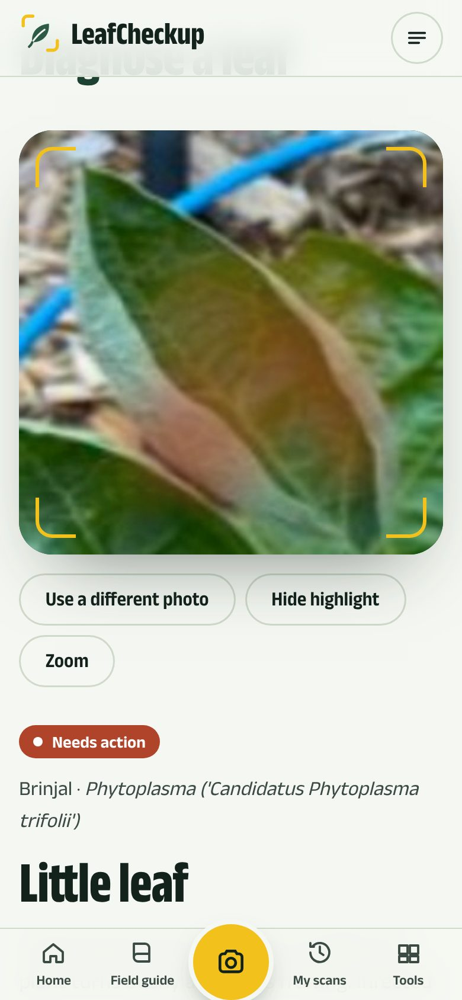
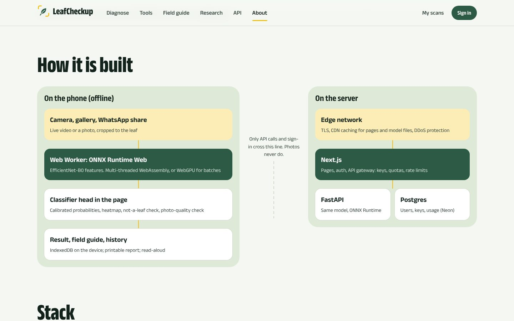

<p align="center">
  
</p>

<h1 align="center">LeafCheckup</h1>

<p align="center">
  <b>Point at a leaf. Know what's wrong.</b><br />
  Free, private crop disease diagnosis that runs entirely on the phone, built on peer-reviewed research.
</p>

<p align="center">
  <a href="https://leafcheckup.vercel.app"><b>leafcheckup.vercel.app</b></a>
  &nbsp;·&nbsp; <a href="https://leafcheckup.vercel.app/research/model-card">Model card</a>
  &nbsp;·&nbsp; <a href="https://leafcheckup.vercel.app/developers">API</a>
  &nbsp;·&nbsp; <a href="https://leafcheckup.vercel.app/about">About</a>
</p>

<p align="center">
  <a href="https://github.com/agarwalpranay02/leafcheckup/actions/workflows/ci.yml"></a>
  <a href="https://github.com/agarwalpranay02/leafcheckup/actions/workflows/security.yml"></a>
  
  
</p>

<p align="center">
  
</p>

A farmer photographs a leaf, or points the phone's camera at it, and in about a tenth of a second LeafCheckup says whether it is healthy or which disease it has. It also shows how confident it is, highlights where it looked, and explains what to do next. The neural network runs inside the browser, so photos never leave the phone and it keeps working without signal once the site has been opened.

It currently covers **ridge gourd** (healthy, leaf miner, yellow mosaic virus) and **brinjal** (healthy, little leaf, Phomopsis blight), trained on two field datasets photographed in Rajasthan, India. Anything else, from a hand to a tomato leaf, is recognised as "not a supported leaf" instead of being given a guess.

## Results

Every number comes from leaves the model never saw during training. Many plant datasets ship several edited copies of each photo; when copies of one leaf land in both the training and the test set, the score measures memory rather than diagnosis. LeafCheckup trains only on original photos, keeps every leaf in exactly one split, merges near-duplicates by perceptual hash and drops photos filed under two different labels.

| | |
|---|---|
| Test accuracy (217 unseen leaves, 6 classes) | **94.9%** (95% bootstrap CI 91.7–97.7%) |
| Macro-F1 | 0.942 |
| Calibration error (ECE, after temperature scaling) | 1.8% |
| "Not a leaf" detection | AUROC 0.993; rejects 90% of non-leaf images and keeps 98.6% of real ones |
| Browser model vs. PyTorch | identical test accuracy; max output difference 4.5 × 10⁻⁵ |
| Speed | about 120 ms per photo on a laptop CPU, in the browser |

**Against the published baseline.** The original DenseNet121 + XGBoost pipeline (MIND 2025) reported 92%. Under its original protocol every test leaf also appeared in training as an augmented copy (545 of 545). Re-run on a leak-free split it scores 92.0% on 88 held-out ridge gourd leaves. **LeafCheckup scores 98.9% on the same 88 leaves.** The full benchmark, confusion matrix and per-class results are on the [model card](https://leafcheckup.vercel.app/research/model-card).

## Features

<table>
<tr>
<td width="50%"></td>
<td width="50%"></td>
</tr>
</table>

- **Live camera diagnosis.** Point the phone at a leaf and the answer updates several times a second, with torch control and a shutter to keep the frame.
- **Explains itself.** A class-activation heatmap shows where the model looked; calibrated confidence and the runner-up conditions are shown alongside.
- **Knows its limits.** An out-of-distribution detector rejects photos that aren't a supported leaf, and a photo-quality check flags blur and poor light.
- **Tells you what to do.** Each condition has a field guide (symptoms, look-alikes, integrated pest management steps) with sources from agricultural universities and ICAR.
- **Field tools.** Batch scan up to 200 photos (WebGPU when available) with CSV and PDF export, field surveys with disease incidence per plot, a 7-day weather risk outlook, a spray mix calculator and on-device scan history.
- **Works like an app.** Installable PWA, works offline, accepts photos shared from WhatsApp or the gallery (Web Share Target), keeps the screen awake during surveys, reads results aloud.
- **Free developer API.** Sign in with Google or an email link, create a key, and call `POST /api/v1/diagnose`. Keys are hashed, and every key has fair-use rate limits and monthly quotas.

<p align="center">
  
  &nbsp;&nbsp;
  
</p>

## How it works

<p align="center"></p>

1. **On the phone.** The photo (or a live video frame) is centre-cropped and sent to a module Web Worker. ONNX Runtime Web runs the EfficientNet-B0 backbone in multi-threaded WebAssembly; the page is cross-origin isolated (COOP/COEP) so it can use several cores. Batch scans use WebGPU and fall back to WebAssembly.
2. **In the page.** A small classifier head applies the calibrated softmax, computes the class activation map for the heatmap, scores the pooled features with a Mahalanobis detector (PCA-128) to reject unsupported images, and checks sharpness and exposure.
3. **On the server.** Next.js serves the pages and acts as the API gateway (auth, API keys, quotas, rate limits). Developer API calls go to a FastAPI service that runs the same ONNX model, so the API and the website always agree.

## Tech stack

| Area | What's used |
|---|---|
| **Machine learning** | PyTorch, timm (EfficientNet-B0, ImageNet weights), AdamW with label smoothing, group-aware stratified splits, dHash near-duplicate detection, temperature scaling, bootstrap confidence intervals, Mahalanobis out-of-distribution detection (PCA-128), class activation maps, ONNX export with parity checks (INT8 quantisation tested and rejected at 42.9%), scikit-learn and XGBoost for the paper baseline |
| **Frontend** | Next.js 16 (App Router, Turbopack, React Server Components), React 19.3 (View Transitions), TypeScript, Tailwind CSS 4, next-intl, Motion, Anek Latin variable font |
| **On-device AI** | ONNX Runtime Web 1.31 in a module Web Worker, multi-threaded WebAssembly via cross-origin isolation, WebGPU, OffscreenCanvas, createImageBitmap |
| **Browser platform** | getUserMedia live camera with torch control, installable PWA with an offline service worker, Web Share Target, Screen Wake Lock, Speech Synthesis, Vibration, IndexedDB (idb-keyval), Clipboard paste and drag-and-drop |
| **Backend** | Next.js route handlers, better-auth (Google OAuth, email magic links), Drizzle ORM, PostgreSQL (Neon in production, PGlite locally), Zod validation, Resend email, rate limiting (in-memory or Upstash) |
| **Inference API** | FastAPI, Uvicorn, ONNX Runtime, NumPy, Pillow, Prometheus metrics |
| **Security** | Strict nonce-based Content-Security-Policy with `strict-dynamic`, HSTS, COOP/COEP/CORP, same-origin CSRF guard, hashed and peppered API keys, upload validation, Permissions-Policy, private vulnerability disclosure policy |
| **Observability** | OpenTelemetry tracing (@vercel/otel), Prometheus metrics on the inference service, structured health checks |
| **Testing** | Playwright end-to-end tests on desktop and mobile (including the live camera with a fake media device), Vitest unit tests, pytest for the inference service, a crawler that checks every page at five screen widths for overflow, broken links and console errors |
| **CI/CD and supply chain** | GitHub Actions (lint, type-check, unit, build, end-to-end), CodeQL, gitleaks, npm audit, pip-audit, Trivy image scanning, Dependabot |
| **Hosting** | Vercel (edge network and serverless functions), Neon serverless Postgres, Render for the inference container. A self-hosted option is included: Docker Compose, Caddy, Cloudflare WAF and CDN, and a hardening script for Ubuntu (UFW limited to Cloudflare, fail2ban, unattended upgrades) |

## Research behind it

- **Paper:** *A Hybrid Deep Learning Approach for Automated Plant Disease Diagnosis in Indian Ridge Gourd: Dataset Creation and Real-World Application*. MIND 2025, MNIT Jaipur; Springer *Communications in Computer and Information Science* (CCIS 2980–2981), 2026. Built a 600-photo field dataset from farms near Jaipur and reached 92.0% with a DenseNet121 + XGBoost hybrid.
- **Review:** [*A comprehensive review and bibliometric analysis of deep learning applications in plant disease detection*](https://doi.org/10.1007/s44163-026-02310-z). *Discover Artificial Intelligence* 6, 1459 (Springer Nature, 2026, open access).
- **Datasets:** ridge gourd leaf dataset on [IEEE DataPort](https://doi.org/10.21227/469z-vm04) and brinjal leaf dataset on [Mendeley Data](https://doi.org/10.17632/c39p3k87g2.1).
- **Design registration:** Government of India design no. 476293-001 for the field data-collection device.
- **Press:** the ridge gourd work was covered by *Punjab Kesari*.

## Repository

```
apps/web/              Next.js app: pages, components, on-device engine, API routes
  public/models/       ONNX model, classifier head, OOD matrix, model card
  e2e/  tests/         Playwright and Vitest suites, page audit, screenshot scripts
services/inference/    FastAPI + ONNX Runtime service behind the developer API
ml/                    Leak-free split, training, export, OOD fitting, baseline replication
  crops.json           The datasets the model is trained on (add a crop here)
infra/                 Self-hosted deployment: Compose, Caddy, backups, server hardening
.github/               CI, security scanning, Dependabot, inference keep-alive
```

## Run it locally

```bash
cd apps/web
npm install
cp .env.example .env.local    # works as is: embedded Postgres, emails printed to the console
npm run dev                   # http://localhost:3000
```

Tests: `npm test` for unit tests; `npm run build && npm start`, then `npx playwright test` for end-to-end; `python -m pytest` in `services/inference`.

Optional API service: `cd services/inference && pip install -r requirements-dev.txt && INFERENCE_TOKEN=<16+ chars> MODEL_DIR=../../apps/web/public/models/effb0-2026.11 uvicorn app.main:app --port 8000`, then set `INFERENCE_URL` and `INFERENCE_TOKEN` in `.env.local`. Or start everything with `docker compose up --build`.

## Guides

- [FREE_HOSTING.md](FREE_HOSTING.md): put it online at no cost on Vercel, Neon and Render
- [DEPLOY.md](DEPLOY.md): run it on your own server behind Cloudflare
- [ADDING_A_CROP.md](ADDING_A_CROP.md): add a new crop from a labelled dataset
- [ml/README.md](ml/README.md): reproduce the model (about 25 minutes on a 2-core CPU)

## Licence

Copyright © 2026 Pranay Agarwal. All rights reserved; see [LICENSE](LICENSE). Third-party components are credited in [NOTICE](NOTICE). Security reports: [SECURITY.md](SECURITY.md).

LeafCheckup gives a second opinion, not an agronomist's diagnosis. Confirm serious or spreading problems with your local Krishi Vigyan Kendra or an agronomist.
